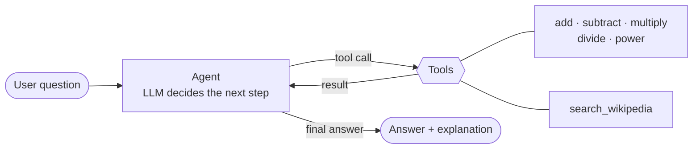

# 🧮 AI Math Assistant

An AI agent that solves math questions written in plain language by **calling tools** instead of guessing.
Built with **LangChain** (`create_agent`) and Python.

> 🇪🇸 [Resumen en español abajo](#-resumen-en-español)

Language models are great with words but unreliable with arithmetic. This agent lets the LLM do what it's good at (understanding the question and planning the steps) and hands every calculation to small, tested Python functions.

Real output, running locally with Ollama (`qwen3:8b`):

```text
$ python -m math_assistant "Add 25 and 15, then multiply by 2"
  🔧 add(numbers=[25, 15])
     → {"result": 40}
  🔧 multiply(numbers=[40, 2])
     → {"result": 80}
The result of adding 25 and 15, then multiplying by 2, is **80**.

$ python -m math_assistant "Divide 100 by 0"
  🔧 divide(numbers=[100, 0])
     → {"error": "Cannot divide by zero."}
Dividing by zero is not allowed. Please provide a valid divisor.

$ python -m math_assistant "¿Cuánto es 2 elevado a 10?"
  🔧 power(base=2, exponent=10)
     → {"result": 1024}
2 elevado a 10 es 1024.
```

It can also look up real-world data before calculating:

```text
$ python -m math_assistant "What is the population of Canada? Multiply it by 0.75"
  🔧 search_wikipedia(query="population of Canada")
     → Population of Canada: Canada ranks 37th by population among countries of the world, comprising about 0.5% of the world's total, with about 41.5 million Canadia…
  🔧 multiply(numbers=[41500000, 0.75])
     → {"result": 31125000}
The population of Canada is approximately 41,500,000. When multiplied by 0.75, the result is **31,125,000**.
```

## How it works



1. The question goes to the agent, built with LangChain's `create_agent`.
2. The LLM reads each tool's **name, typed arguments and docstring**, and decides which tool to call and with what inputs.
3. The tool runs real Python code and returns `{"result": ...}` or `{"error": ...}`.
4. The loop repeats until no more tools are needed, so multi-step problems get solved one operation at a time.

## Features

- **6 tools:** `add`, `subtract`, `multiply`, `divide`, `power` and `search_wikipedia`.
- **Typed tool schemas:** tools take `numbers: list[float]` or `base, exponent`, so the LLM extracts the numbers (including words like "two") and the tools only do math.
- **Errors the LLM can read:** division by zero, overflow, `0^-1`, `(-8)^0.5`, empty or invalid input all return a clear message instead of crashing.
- **Clean numbers:** `0.1 + 0.2` gives `0.3`, and `40.0` is shown as `40`.
- **Runs free and locally** with [Ollama](https://ollama.com) (default), or with OpenAI / IBM watsonx.ai Granite, chosen with one environment variable.
- **Conversation memory** in the interactive chat, and it replies in the user's language.
- **34 automated tests**, including an end-to-end agent test with a scripted fake LLM, so CI runs with no API key.

## Project structure

```text
math_assistant/
├── operations.py   # pure math logic (no LangChain), easy to test
├── tools.py        # @tool wrappers: schemas + descriptions for the LLM
├── wiki.py         # small Wikipedia API client
├── llm.py          # picks Ollama, OpenAI or watsonx from environment variables
├── agent.py        # create_agent + system prompt
└── __main__.py     # command-line chat
tests/
├── test_operations.py
└── test_agent.py   # full agent loop with a fake model
```

## Getting started

**Requirements:** Python 3.10+ and [Ollama](https://ollama.com) (free, no API key).

```bash
# 1. Get a local model that supports tool calling (~5 GB)
ollama pull qwen3:8b

# 2. Install the project
git clone https://github.com/laulys/ai-math-assistant.git
cd ai-math-assistant
python3 -m venv .venv
source .venv/bin/activate        # Windows: .venv\Scripts\activate
pip install -r requirements.txt
cp .env.example .env             # works as-is with Ollama
```

Run it:

```bash
python -m math_assistant                          # interactive chat
python -m math_assistant "What is 2 to the power of 10?"
python -m math_assistant --quiet "Divide 100 by 5 and then by 2"
```

**Other providers:** set `LLM_PROVIDER=openai` and `OPENAI_API_KEY` in `.env` to use OpenAI. For IBM watsonx, run `pip install langchain-ibm`, set `LLM_PROVIDER=watsonx` and fill in the `WATSONX_*` values. Any other Ollama model with tool support works too (`OLLAMA_MODEL`).

## Running the tests

```bash
pip install -r requirements-dev.txt
pytest
```

The tests need no API key and no internet. GitHub Actions runs them on every push.

## What I learned / improvements over the course lab

This project started as the guided lab *"Build an AI Math Assistant with LangChain Tool Calling"* from IBM Skills Network. I rebuilt it as a standalone project and changed a few things:

| In the lab | In this project |
|---|---|
| Tools parse numbers out of a raw string (`"10 20 30"`) | Typed arguments (`numbers: list[float]`): the LLM extracts the numbers, the tool only does math |
| `subtract` used `isdigit()`, which ignores negatives and decimals | All operations handle negatives and decimals |
| Some edge cases crashed or returned odd values | Every bad input returns a readable `{"error": ...}` |
| Logic and tool wrappers mixed together | Pure logic in `operations.py`, tested separately |
| Wikipedia library needed a monkey-patch for its User-Agent | Small direct API client with a proper User-Agent |
| Manual checks in notebook cells | `pytest` suite + GitHub Actions CI |

Key ideas: how tool calling works, why docstrings and type hints are part of the prompt, why small local models need short and strict instructions (a softer system prompt let `qwen3:8b` skip the tools on 2 of 6 test questions; the current one used them on 6 of 6), how `create_agent` loops between the model and the tools, and how to test an agent without paying for API calls.

## Credits

Based on the IBM Skills Network guided project *Build an AI Math Assistant with LangChain Tool Calling* (authors: Joseph Santarcangelo and Kunal Makwana). The code in this repository is my own reimplementation.

---

## 🇪🇸 Resumen en español

**AI Math Assistant** es un agente de IA que resuelve preguntas de matemáticas escritas en lenguaje natural. El modelo de lenguaje (Qwen local con Ollama, OpenAI o IBM Granite) **no hace las cuentas "de memoria"**: entiende la pregunta, decide qué herramienta usar (sumar, restar, multiplicar, dividir, potencia o buscar en Wikipedia) y deja que funciones de Python hagan el cálculo exacto.

**Qué demuestra este proyecto:**
- Construcción de agentes con LangChain (`create_agent`) y *tool calling*.
- Herramientas con esquemas tipados y descripciones pensadas para el LLM.
- Manejo de errores (división entre cero, números demasiado grandes, entradas inválidas).
- Combinación de búsqueda de información y cálculo en varios pasos.
- Pruebas automatizadas (34 tests) e integración continua con GitHub Actions.

**Cómo usarlo:** sigue los pasos de [Getting started](#getting-started). Necesitas Python 3.10 o superior y [Ollama](https://ollama.com): funciona **gratis y en tu propia computadora**, sin clave de API. Puedes escribirle en español y te responderá en español.

Basado en el laboratorio guiado de IBM Skills Network, reimplementado y mejorado como proyecto independiente.
